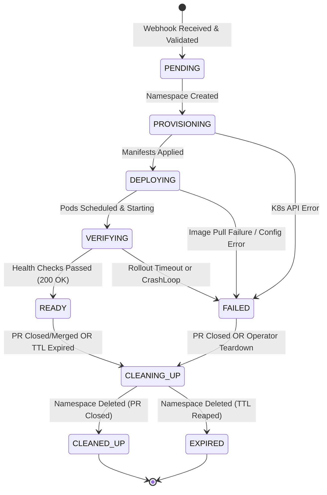
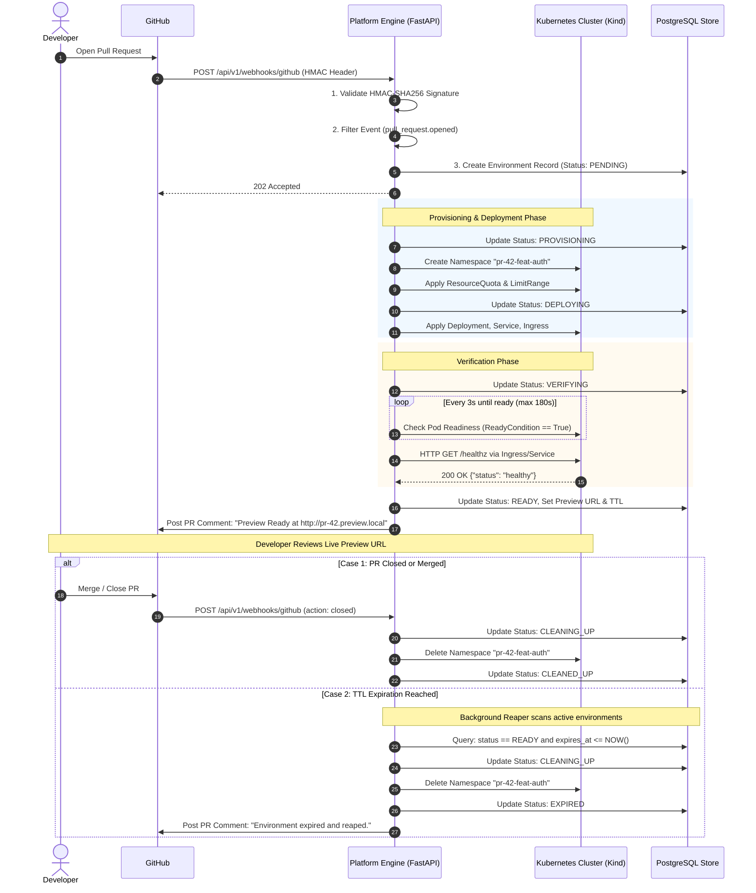

# Developer & Environment Lifecycle (Proposed)

> [!IMPORTANT]
> **Status**: Proposed Design (Phase 0)  
> This document details the end-to-end lifecycle of an ephemeral preview environment from the moment a developer opens a GitHub pull request to final cleanup. **All workflows and state models described below represent planned functionality.**

---

## 1. Lifecycle State Machine

An ephemeral environment progresses through a strictly defined state machine. State transitions are validated and persisted to prevent illegal jumps (e.g., an unverified environment transitioning directly to `READY`).

### Proposed State Definitions

| State | Meaning | Trigger |
| :--- | :--- | :--- |
| `PENDING` | Webhook received, HMAC verified, and environment queued for provisioning. | GitHub `pull_request: opened` event. |
| `PROVISIONING` | Dedicated Kubernetes namespace is being created with ResourceQuotas and RBAC. | Provisioning worker starts job. |
| `DEPLOYING` | Kubernetes Workload manifests (Deployment, Service, Ingress) are being submitted. | Namespace is active and confirmed. |
| `VERIFYING` | Pod readiness probes and HTTP health checks (`/healthz`) are being polled. | Deployment submitted to K8s API. |
| `READY` | Pods are 100% ready, HTTP health probe returned `200 OK`, preview URL published. | Health check verification succeeds. |
| `FAILED` | Deployment failed (e.g., `CrashLoopBackOff`, `ImagePullBackOff`, or verification timeout). | Health check failed or timeout expired. |
| `CLEANING_UP` | Teardown initiated; Kubernetes namespace deletion in progress. | PR closed/merged, TTL expired, or manual delete. |
| `EXPIRED` | Namespace successfully deleted because the configured TTL elapsed. | TTL reaper confirms namespace deletion. |
| `CLEANED_UP` | Namespace successfully deleted following a PR closure or operator request. | Teardown confirms namespace deletion. |

*Note: The exact state enums and transition validations will be finalized during Phase 3 and Phase 6 implementation.*

---

## 2. End-to-End Operational Lifecycle

---

## 3. Detailed Step-by-Step Breakdown

### Step 1: Receiving the GitHub Event
A developer creates or updates a pull request on GitHub. GitHub fires an HTTP POST payload containing event data (PR number, commit SHA, branch name, action) to the platform's webhook endpoint `/api/v1/webhooks/github`.

### Step 2: Validating the Webhook HMAC
Before processing any data, the engine checks the `X-Hub-Signature-256` HTTP header. It calculates the HMAC-SHA256 hash of the raw payload using a configured secret key. If the signatures do not match, the request is immediately terminated with HTTP `401 Unauthorized` to prevent spoofing.

### Step 3: Validating Repository and PR Event
The engine inspects the payload body to verify:
- Target repository is registered with the platform.
- The action is an actionable event: `opened`, `reopened`, `synchronize`, or `closed`.
- If an unsupported action is received (e.g., `labeled`), it returns HTTP `200 OK` with `ignored` status.

### Step 4 & 5: Image Resolution & Build Pipeline
The platform checks whether an image corresponding to the PR commit SHA exists:
- In production / CI: GitHub Actions builds the container image and tags it with the commit SHA (`app:pr-42-<sha>`).
- In local development: The image is either pulled from a local registry or loaded into Kind via `kind load docker-image`.
- The engine will not proceed with deployment until the image tag is confirmed available.

### Step 6: Creating the Isolated Kubernetes Environment
The engine invokes the Kubernetes API to provision a dedicated namespace named `pr-<pr_number>-<sanitized_branch>`.
The namespace is configured with:
- Standard labels (`eep.platform/pr-number`, `eep.platform/expires-at`).
- A `ResourceQuota` limiting CPU, memory, and maximum pods.
- A `LimitRange` assigning default CPU/memory requests and limits to containers.

### Step 7: Applying Deployment Configurations
The engine renders Kubernetes YAML templates (or constructs objects programmatically) for:
- **Deployment**: Configured with the specific PR image tag, resource requests, and readiness/liveness probes.
- **Service**: Exposing the pod's container port internally as `ClusterIP`.
- **Ingress**: Establishing an HTTP host rule (e.g., `pr-42.preview.local` or path-based route) directing traffic to the Service.

### Step 8: Verifying Rollout Status and Pod Readiness
The engine does not assume deployment success. It enters a polling loop (e.g., every 3 seconds for up to 180 seconds):
- Queries the Kubernetes Deployment status.
- Inspects conditions for `Available = True` and `Progressing = True`.
- Confirms all desired replicas are running and ready.

### Step 9: Application Health Check
Once pod readiness gates report healthy, the platform issues an HTTP `GET` request directly to the workload's `/healthz` endpoint via the cluster network. A valid HTTP `200` response confirms that the application runtime has started successfully.

### Step 10: Publishing Preview Access
Only after Step 9 succeeds:
- The environment status in the database is updated to `READY`.
- The preview URL is saved.
- An automated comment is posted to the GitHub pull request containing the clickable preview link, commit SHA, and remaining TTL duration.

### Step 11: Tracking Environment State and Lifecycle Events
Every step produces an event record in the `LifecycleEvent` table. Developers and operators can inspect exact event timing (e.g., time to create namespace, time to verify health).

### Step 12: Handling Deployment Failures
If an error occurs (e.g., pod in `CrashLoopBackOff`, image not found, or health check timeout):
- Status transitions to `FAILED`.
- The failure reason, pod termination messages, and recent container logs are captured into the database.
- A comment is posted to the PR detailing the failure so the developer can troubleshoot.
- The namespace is retained for a configurable grace period (e.g., 30 minutes) to allow debugging before cleanup.

### Step 13: Handling Repeated Webhook Events (Idempotency)
When a developer pushes new commits to an open PR (`synchronize` action):
- The platform identifies the existing active environment.
- Instead of creating a new namespace, it performs a rolling update of the existing Deployment with the new image tag.
- It re-executes the health verification loop (Steps 8–9).
- Webhooks received out of order or duplicated are checked against commit timestamps to prevent regressions.

### Step 14: TTL-Based Expiration
Each environment is assigned a default TTL (e.g., 2 hours). A background reaper daemon continuously checks for expired environments. When expired:
- Status transitions to `CLEANING_UP`.
- The namespace is deleted.
- The status updates to `EXPIRED`.

### Step 15 & 16: PR Closure Cleanup & Retries
When a PR is closed or merged:
- The `pull_request: closed` webhook triggers namespace deletion.
- The platform waits for Kubernetes to confirm the namespace is completely removed.
- If deletion fails (e.g., transient network glitch), the cleanup task is queued for retry.
- Once verified, status is marked `CLEANED_UP`.

### Step 17: Operator & Self-Service Overrides
Authorized operators or developers using the Developer Dashboard (Phase 7) or REST API can:
- Manually trigger an immediate cleanup of any environment.
- Extend the TTL of an active environment (e.g., "+2 hours").
- Trigger a redeployment or health check re-run.

