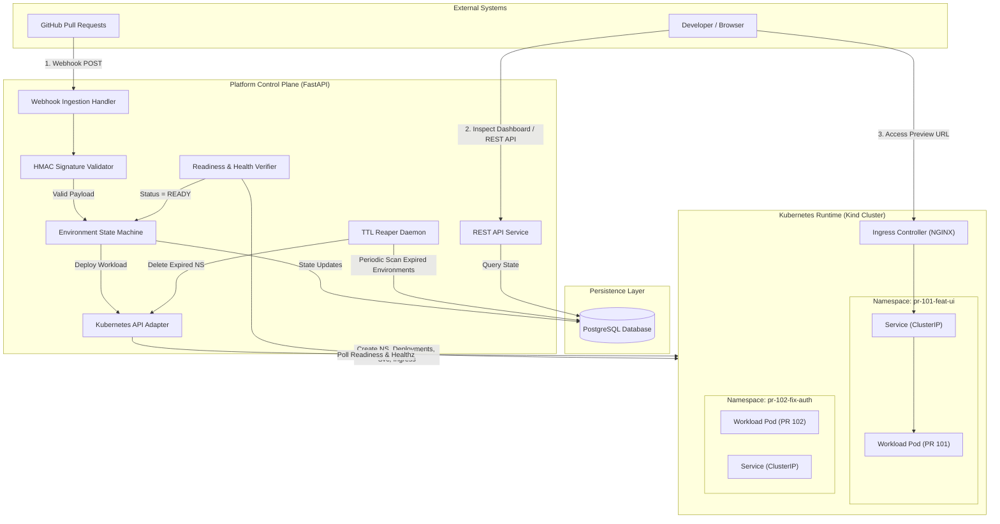
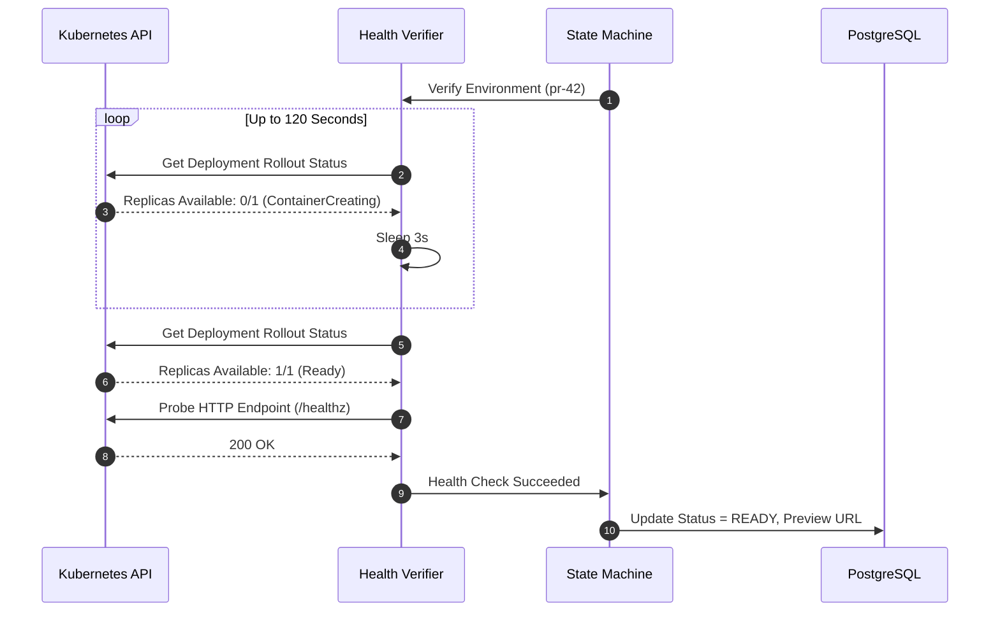

# System Architecture (Proposed)

> [!IMPORTANT]
> **Status**: Conceptual & Proposed Architecture (Phase 0)  
> This document describes the planned architectural design for the Ephemeral Environment Provisioning Platform. **No system components, microservices, or databases have been implemented or deployed yet.**

---

## 1. Architectural Overview

The platform follows a **modular control-plane architecture** designed to bridge developer events (GitHub pull requests) with Kubernetes infrastructure orchestration.

The system is organized into three primary conceptual tiers:
1. **Integration & API Tier**: Ingests GitHub webhooks, validates payloads, and serves REST APIs.
2. **Orchestration & Control Tier**: Manages the environment state machine, calculates TTLs, coordinates Kubernetes API operations, and runs background health probes and reapers.
3. **Cluster Runtime Tier**: A local Kubernetes cluster (Kind) executing isolated preview namespaces, ingress routing, and workload pods.

---

## 2. Main System Components

---

## 3. Component Responsibilities

| Component | Technology | Primary Responsibilities |
| :--- | :--- | :--- |
| **Webhook Ingestion Handler** | FastAPI router | Accepts incoming HTTP POST requests from GitHub; returns immediate `202 Accepted` after basic schema validation. |
| **HMAC Signature Validator** | Python `hashlib` / `hmac` | Verifies the `X-Hub-Signature-256` header against the shared secret; rejects forged or altered payloads. |
| **Environment State Machine** | Python service layer | Governs legal environment state transitions (e.g., `PENDING` -> `PROVISIONING` -> `DEPLOYING` -> `VERIFYING` -> `READY` / `FAILED` -> `CLEANING_UP` -> `CLEANED_UP`). |
| **Kubernetes API Adapter** | `kubernetes-client` (Python) | Translates internal lifecycle commands into declarative Kubernetes API requests (`create_namespace`, `apply_deployment`, `delete_namespace`). |
| **Health & Readiness Verifier** | Python async worker | Polls Kubernetes Deployment rollout status and executes HTTP probes against application `/healthz` endpoints. |
| **TTL Reaper Daemon** | Async background task | Periodically identifies environments whose scheduled lifetime has expired and triggers automated teardown. |
| **REST API Service** | FastAPI endpoints | Exposes programmatic control for the developer dashboard (list environments, view logs, extend TTL, force cleanup). |
| **PostgreSQL Database** | PostgreSQL 16 | Persists environment entities, configuration hashes, state transitions, and audit logs. |
| **Kubernetes Runtime** | Kind (Local) | Runs containerized applications within dedicated, resource-quota-bounded namespaces. |

---

## 4. Component Interactions & Workflows

### A. Pull Request to Preview Workflow (Provisioning)

1. **Trigger**: A developer pushes a commit or opens a PR on GitHub.
2. **Webhook Receipt**: GitHub sends a `pull_request` event payload to `/api/v1/webhooks/github`.
3. **Authentication**: The HMAC validator computes the SHA256 digest of the raw body using the platform secret and asserts equality.
4. **State Initialization**: The platform creates a new `Environment` record in PostgreSQL with status `PROVISIONING`.
5. **Namespace Allocation**: The Kubernetes adapter creates a dedicated namespace `pr-<number>-<hash>`.
6. **Workload Deployment**: Manifests (Deployment, Service, Ingress) are generated from templates, populating the target container image tag corresponding to the PR commit SHA.
7. **Readiness Gate**: The Health Verifier monitors pod startup until `Ready=True`.
8. **HTTP Verification**: An HTTP request is dispatched to the workload's `/healthz` probe.
9. **Exposition**: Upon successful verification, status is marked `READY`, the preview URL is generated, and a PR comment is dispatched to GitHub.

---

### B. Health Verification Workflow

If the deployment fails to become ready within the timeout period (e.g., 180 seconds) or the container crashes in a `CrashLoopBackOff`, the Health Verifier transitions the environment to `FAILED`, captures the pod termination logs, and persists the diagnostic failure in the database.

---

### C. TTL-Based Expiration Workflow

Every provisioned environment is tagged with an expiration timestamp:
$$\text{expires\_at} = \text{created\_at} + \text{TTL\_DURATION}$$

1. The **TTL Reaper Daemon** wakes up on a periodic interval (e.g., every 60 seconds).
2. It queries PostgreSQL for environments where `status = READY` and `expires_at <= NOW()`.
3. For each expired environment:
   - Status transitions to `CLEANING_UP`.
   - The Kubernetes adapter calls `delete_namespace(name)`.
   - Upon confirmation of namespace deletion, status transitions to `EXPIRED` / `CLEANED_UP`.
   - A lifecycle event is logged.

---

### D. Pull Request Closure Cleanup Workflow

1. A developer merges or closes PR #42.
2. GitHub sends a `pull_request` webhook with `action: closed`.
3. The platform matches the repository and PR number against active database records.
4. If an active environment exists, the status transitions to `CLEANING_UP`.
5. The Kubernetes namespace and associated resources are immediately queued for deletion.
6. Once deleted, the record is updated to `CLEANED_UP` and audit logs are recorded.

---

## 5. Error Handling and Recovery

| Failure Scenario | Detection Mechanism | Platform Recovery Action |
| :--- | :--- | :--- |
| **Invalid Webhook HMAC** | Header verification mismatch | Return HTTP `401 Unauthorized`; discard payload; log security audit alert. |
| **Image Pull Failure (`ErrImagePull`)** | K8s Pod status inspection | Mark status `FAILED`; extract image tag from pod event; log error diagnostics. |
| **Pod Crash Loop (`CrashLoopBackOff`)** | Container status probe | Mark status `FAILED`; capture container stdout/stderr logs for developer review. |
| **Readiness Timeout (180s expired)** | Health verification loop | Mark status `FAILED`; retain namespace temporarily for debugging; alert PR. |
| **Namespace Deletion Stuck** | Finalizer deadlock monitoring | Check for remaining resources; force removal of blocking finalizers if safe. |
| **Platform Engine Restart** | DB reconciliation on startup | Engine queries K8s for actual namespace states vs DB; resumes TTL watchers. |

---

## 6. Security Boundaries

1. **Network Isolation**: Preview environments are restricted from reaching internal platform control services via Kubernetes NetworkPolicies.
2. **Resource Boundaries**: Each namespace is bound by a strict `ResourceQuota` (e.g., max 2 CPUs, 2GiB RAM, 10 pods) preventing host resource exhaustion.
3. **Execution Privileges**: Preview workloads run as non-root users with read-only root filesystems where possible.
4. **RBAC Segregation**: The platform engine interacts with Kubernetes using a dedicated `ServiceAccount` with permissions scoped strictly to preview namespaces.

---

## 7. System State & Data Tracking

The platform tracks the following entity models in PostgreSQL:

- **Environment**:
  - `id`: UUID (Primary Key)
  - `pr_number`: Integer (e.g., 42)
  - `repo_name`: String (e.g., `octocat/demo-app`)
  - `commit_sha`: String (Git commit hash)
  - `namespace`: String (e.g., `pr-42-a8f9c1`)
  - `status`: Enum (`PENDING`, `PROVISIONING`, `DEPLOYING`, `VERIFYING`, `READY`, `FAILED`, `CLEANING_UP`, `EXPIRED`, `CLEANED_UP`)
  - `preview_url`: String (or null if not ready)
  - `created_at`: UTC Timestamp
  - `updated_at`: UTC Timestamp
  - `expires_at`: UTC Timestamp (scheduled TTL)
  - `cleaned_at`: UTC Timestamp (or null)

- **LifecycleEvent**:
  - `id`: UUID
  - `environment_id`: Foreign Key referencing `Environment`
  - `event_type`: String (e.g., `WEBHOOK_RECEIVED`, `NAMESPACE_CREATED`, `HEALTH_CHECK_PASSED`, `TTL_EXPIRED`)
  - `details`: JSONB payload containing diagnostic data or error messages
  - `timestamp`: UTC Timestamp

---

## 8. Unresolved Architectural Decisions

The following items are under active review in [docs/ARCHITECTURE-DECISIONS.md](ARCHITECTURE-DECISIONS.md):
- **ADR-003**: Controller concurrency model (single-process asyncio worker vs. background Celery/Redis task queue).
- **ADR-005**: Dynamic local DNS routing vs. path-based port forwarding.
- **ADR-010**: Controller placement (running outside cluster in WSL2 vs. in-cluster pod).

